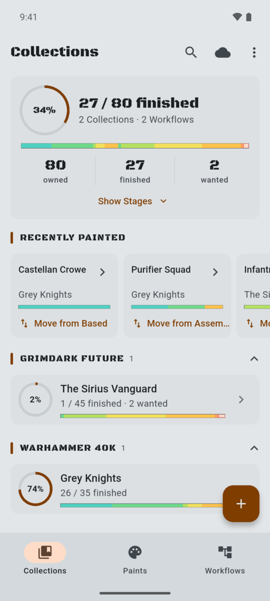
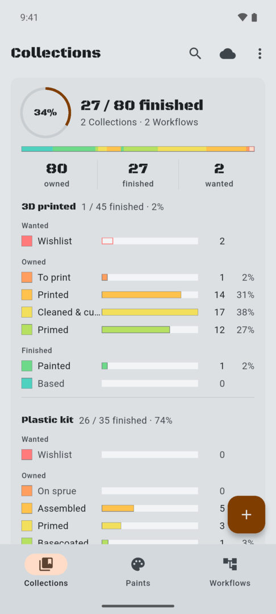
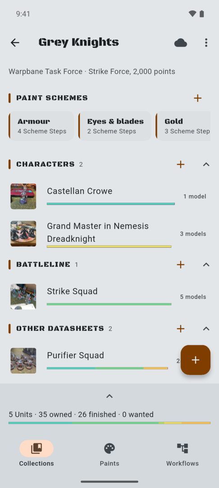
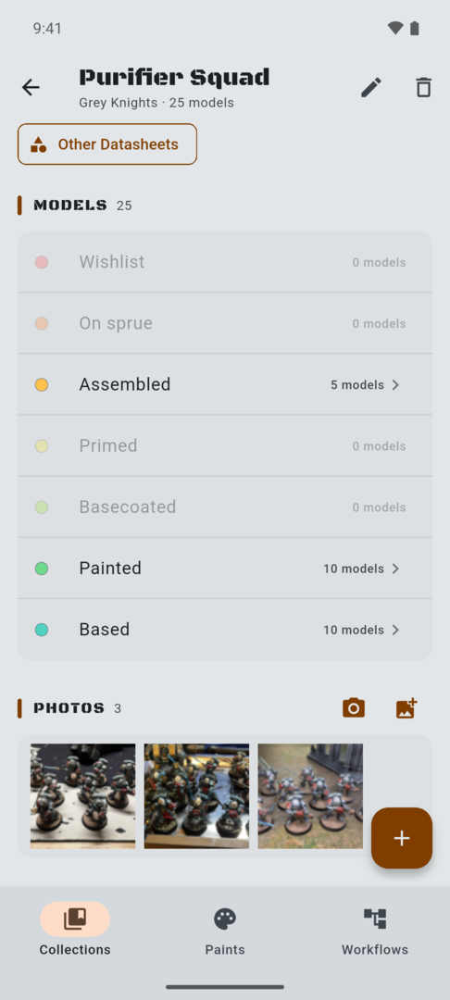
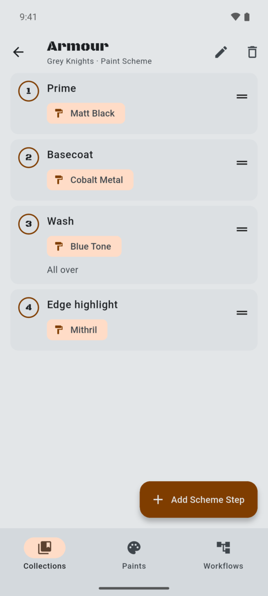
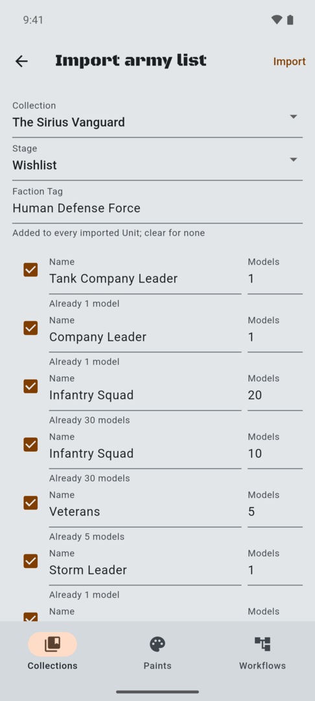
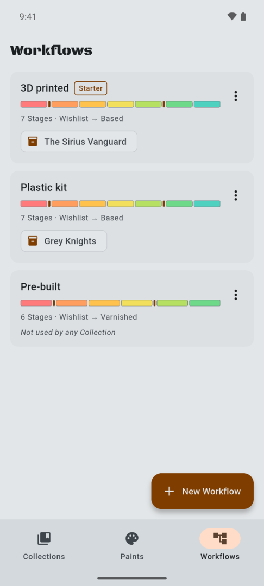
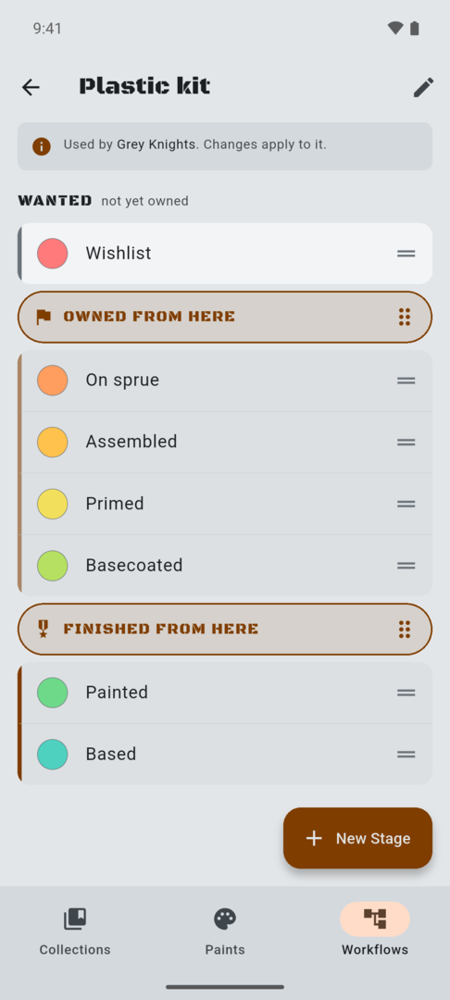
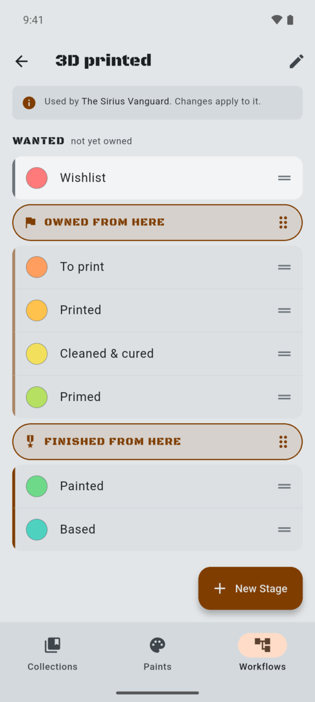

# Mini Vault

Track every miniature in your collection from wishlist to finished, in any game system. Each model sits at a Stage of
a Workflow you define, such as on the sprue, primed, painted or based. Mini Vault shows how far each Unit, Collection and your
whole hobby has come. It works offline and syncs between devices.

| | | |
|:-:|:-:|:-:|
|  |  |  |
| Collections across Game Systems | Progress per Stage | A Collection by Category |
|  |  |  |
| A Unit's models across Stages | A Paint Scheme, step by step | Import from the 40k app or Army Forge |
|  |  |  |
| Your own Workflows | Plastic kit: from the sprue | 3D printed: from the printer |

## Get the app

Android: download the APK from the latest [GitHub Release](https://github.com/ItsMajorSpace/mini-vault/releases/latest)
and install it.

Privacy: Mini Vault stores only your account email, your Collections and your photos, and has no ads or tracking. See
the [privacy policy](https://itsmajorspace.github.io/mini-vault/privacy/).

## How it's built

| Package | What it is |
|---|---|
| [`app/`](app) | The Flutter app. It keeps a local SQLite database that PowerSync keeps in sync. |
| [`domain_core/`](domain_core) | The domain model and rules in pure Dart, shared by the app and the server. Also holds the army list parsers. |
| [`server/`](server) | The Dart write API plus the Docker Compose stack: Postgres, GoTrue (auth), PowerSync and Mailpit. |

All three are one [Dart workspace](pubspec.yaml). The words used throughout (Collection, Unit, Batch, Stage and the rest) are defined in
[GLOSSARY.md](GLOSSARY.md). The reasoning behind the bigger choices is in [docs/adr/](docs/adr).

## Working on it

You need Flutter (CI uses 3.50.0), Docker, and an Android emulator.

Start the server stack:

```bash
cd server && cp -n .env.example .env && docker compose up -d --build --wait
```

Run the app. Its defaults already point at the local stack through the emulator's `10.0.2.2`. Pass
`--dart-define=AUTH_URL=…` (likewise `POWERSYNC_URL` and `API_URL`) to point it somewhere else:

```bash
cd app && flutter run
```

Create an account in the app. Locally, sign-up needs no email confirmation, and Mailpit at
http://localhost:8025 catches password-reset emails.

Run the checks the same way CI does. The server tests need the stack running:

```bash
flutter pub get && dart analyze && dart format --output=none --set-exit-if-changed .
```

```bash
(cd domain_core && dart test) && (cd app && flutter test) && (cd server && dart test)
```

Issues and triage labels are covered in [docs/agents/](docs/agents). Deploying the server and cutting an app release
are covered in [docs/deploy.md](docs/deploy.md) and [docs/releasing.md](docs/releasing.md).

## License

Source-available under the [PolyForm Noncommercial License 1.0.0](LICENSE): free for any non-commercial use.
